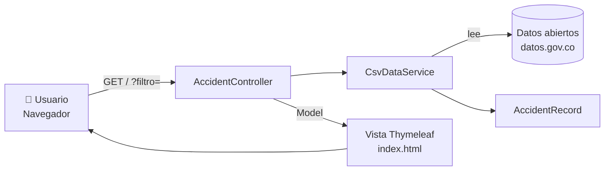
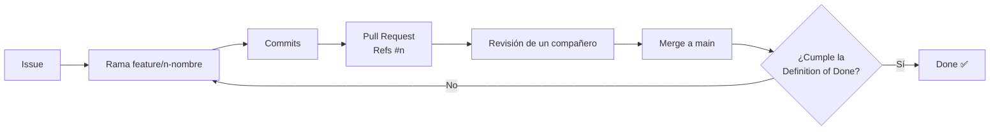

<div align="center">

# 🚦 SenaTraffic

### Puntos críticos de accidentalidad vial en Bogotá, a partir de Datos Abiertos de Colombia


**Hackathon Java + Spring Boot · SENA**
*Construye, aprende e innova.*

[Problema](#-el-problema) · [Datos](#-fuente-de-datos) · [Funcionalidades](#-funcionalidades) · [Ejecución](#-cómo-ejecutar) · [Pruebas](#-pruebas) · [Gestión ágil](#-gestión-ágil-scrum--github)

</div>

---

## 📌 El problema

En Bogotá, los peatones, ciclistas y conductores no cuentan con una forma sencilla de saber **en qué zonas de la ciudad se concentran los accidentes viales** y de qué tipo son. La información existe en el portal de datos abiertos, pero es difícil de consultar para un ciudadano común.

| | |
|---|---|
| 👥 **Beneficiarios** | Peatones, ciclistas, motociclistas y conductores de Bogotá |
| ❓ **Necesidad** | Identificar rápidamente zonas críticas para tomar precauciones en sus rutas |
| 💡 **Solución** | Una aplicación web que consulta, filtra y resume los datos oficiales de accidentalidad |

## 🎯 Product Goal

> Ayudar a los ciudadanos de Bogotá a identificar zonas críticas de accidentalidad vial usando datos abiertos oficiales.

## 🏁 Sprint Goal

> Entregar una aplicación web que consulte datos reales de accidentalidad, los filtre y muestre un resumen de las localidades más críticas.

---

## 📊 Fuente de datos

| Campo | Detalle |
|---|---|
| **Portal** | [datos.gov.co](https://www.datos.gov.co/) |
| **Conjunto de datos** | `COMPLETAR: nombre exacto del dataset` |
| **URL del dataset** | `COMPLETAR: https://www.datos.gov.co/...` |
| **Entidad responsable** | Secretaría Distrital de Movilidad *(confirmar con la ficha del dataset)* |
| **Modalidad de acceso** | `COMPLETAR: API (SODA/JSON) o archivo CSV descargado` |
| **Período cubierto** | `COMPLETAR` |
| **Territorio** | Bogotá D.C. |
| **Última actualización** | `COMPLETAR` |
| **Registros utilizados** | `COMPLETAR: total o tamaño de la muestra y cómo se obtuvo` |

### ⚠️ Limitaciones conocidas

- `COMPLETAR: ej. algunos registros no tienen localidad o fecha.`
- `COMPLETAR: ej. el conjunto no se actualiza en tiempo real.`
- Los resultados dependen de la calidad de los datos publicados por la entidad y no reemplazan información oficial de tránsito.

---

## ✨ Funcionalidades

- [x] Interfaz web accesible desde el navegador
- [x] Tabla de registros de accidentalidad
- [x] Filtro por localidad o tipo de vehículo
- [x] Mensaje cuando la búsqueda no arroja resultados
- [ ] Datos reales de datos.gov.co en lugar de datos de ejemplo
- [ ] Resumen: Top 5 de localidades con más accidentes
- [ ] Búsqueda insensible a mayúsculas y tildes
- [ ] Manejo de errores de carga de datos
- [ ] Pruebas automatizadas con JUnit

> Marca cada casilla únicamente cuando la funcionalidad esté terminada y verificada (ver [Definition of Done](#-definition-of-done)).

---

## 🏗️ Arquitectura



### Estructura del proyecto

```text
src/
├── main/
│   ├── java/com/sena/hackathon/
│   │   ├── HackathonApplication.java     # Punto de entrada Spring Boot
│   │   ├── controller/
│   │   │   └── AccidentController.java   # Recibe la petición y aplica el filtro
│   │   ├── service/
│   │   │   └── CsvDataService.java       # Carga los datos
│   │   └── model/
│   │       └── AccidentRecord.java       # Representa un registro
│   └── resources/
│       ├── data/                         # Archivo de datos (CSV)
│       ├── static/css/style.css          # Estilos
│       ├── templates/index.html          # Vista principal
│       └── application.properties
└── test/java/com/sena/hackathon/         # Pruebas JUnit
```

---

## 🛠️ Tecnologías

| Capa | Herramientas |
|---|---|
| Backend | Java 17, Spring Boot 3.2, Spring MVC, Maven |
| Frontend | HTML5, CSS3, Thymeleaf, Bootstrap 5 (CDN) |
| Pruebas | JUnit 5, Spring Boot Test |
| Gestión | Git, GitHub, GitHub Issues, GitHub Projects |

---

## 🚀 Cómo ejecutar

### Requisitos

- ☕ **JDK 17** o superior
- 📦 **Maven 3.8+** (o usar el IDE: VS Code con *Extension Pack for Java*, IntelliJ, Eclipse)
- 🌐 Conexión a internet (Bootstrap se carga por CDN)

### Pasos

```bash
# 1. Clonar el repositorio
git clone https://github.com/ALMEJIA21/hackathon-datos-abiertos.git
cd hackathon-datos-abiertos

# 2. Ejecutar la aplicación
mvn spring-boot:run
```

También puedes abrir el proyecto en tu IDE y ejecutar la clase `HackathonApplication.java`.

### Abrir en el navegador

👉 **http://localhost:8080**

### Ejemplos de uso

| Acción | Resultado esperado |
|---|---|
| Abrir `http://localhost:8080` | Tabla con todos los registros |
| Buscar `bosa` | Solo registros de la localidad Bosa |
| Buscar `motocicleta` | Solo registros de ese tipo de vehículo |
| Buscar un texto inexistente | Mensaje "No se encontraron registros" |

---

## 🧪 Pruebas

```bash
mvn test
```

| Verificación | Estado |
|---|---|
| Carga de datos en el servicio | ⬜ Pendiente |
| Filtro por localidad y vehículo | ⬜ Pendiente |
| Respuesta de `GET /` | ⬜ Pendiente |

> Actualiza esta tabla con el resultado real de la ejecución.

---

## 🔄 Gestión ágil (Scrum + GitHub)

| Elemento | Enlace |
|---|---|
| 📋 GitHub Project (tablero) | `COMPLETAR: enlace al Project` |
| 🐛 Issues | [Ver Issues](https://github.com/ALMEJIA21/hackathon-datos-abiertos/issues) |
| 🔀 Pull Requests | [Ver Pull Requests](https://github.com/ALMEJIA21/hackathon-datos-abiertos/pulls) |

**Estados del tablero:** `Backlog` → `Ready` → `In Progress` → `In Review` → `Done`

### Flujo de trabajo



### Product Backlog

| # | Ítem | Prioridad | Estado |
|---|---|---|---|
| 1 | Datos reales de datos.gov.co | Alta | `COMPLETAR` |
| 2 | Resumen de localidades críticas | Alta | `COMPLETAR` |
| 3 | Filtro robusto y manejo de errores | Media | `COMPLETAR` |
| 4 | Pruebas automatizadas | Alta | `COMPLETAR` |
| 5 | Limpieza y documentación | Media | `COMPLETAR` |

---

## ✅ Definition of Done

- [ ] La aplicación inicia sin errores bloqueantes
- [ ] La interfaz web permite completar el recorrido principal
- [ ] La funcionalidad responde al problema seleccionado
- [ ] Se utilizan datos reales del conjunto documentado
- [ ] La fuente de información está identificada
- [ ] Los resultados pueden verificarse
- [ ] Se realizó al menos una comprobación funcional documentada
- [ ] Los cambios están integrados en la rama principal
- [ ] Se realizó la revisión de código
- [ ] El README permite ejecutar la aplicación
- [ ] Los errores bloqueantes fueron corregidos
- [ ] El estado de GitHub Projects coincide con el trabajo realmente completado

---

## 🔁 Retrospectiva

| Pregunta | Respuesta del equipo |
|---|---|
| ✅ ¿Qué funcionó bien? | `COMPLETAR` |
| ⚠️ ¿Cuál fue la principal dificultad? | `COMPLETAR` |
| 🔧 ¿Qué mejoraríamos? | `COMPLETAR` |
| 🎯 **Acción concreta de mejora** | `COMPLETAR` |

---

## 👥 Equipo

| Integrante | Aporte principal | GitHub |
|---|---|---|
| `COMPLETAR` | `COMPLETAR` | [@ALMEJIA21](https://github.com/ALMEJIA21) |
| `COMPLETAR` | `COMPLETAR` | `@usuario` |

---

## 📄 Licencia y uso de datos

Proyecto con fines educativos desarrollado en el marco del Hackathon Java + Spring Boot del SENA.
Los datos pertenecen a sus entidades publicadoras y se utilizan según las condiciones de uso del portal [datos.gov.co](https://www.datos.gov.co/).

<div align="center">

**Construye, aprende e innova.** 🚀

</div>
